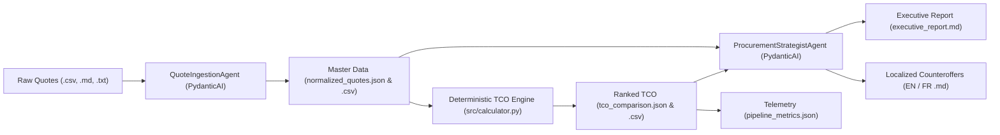

# Autonomous Procurement Data Swarm


An autonomous, multi-agent procurement data engineering and deterministic Total Cost of Ownership (TCO) pipeline built with **PydanticAI** and **Pydantic v2**. It ingests messy, multilingual supplier quotations (`.csv`, `.md`, `.txt` OCR dumps in English and French), enforces strict zero-hallucination schema normalization, runs a **100% deterministic financial TCO & delivery-risk engine**, and generates an executive award recommendation alongside localized (`en` / `fr`) negotiation counteroffer drafts.

---

## Executive Summary

Industrial sourcing teams lose hours manually reconciling heterogeneous supplier quotations across currencies (`USD`, `EUR`, `MXN`), Incoterms (`DDP`, `FOB`, `EXW`, or unconfirmed), unit systems (`business_days`, `calendar_days`, `weeks`, or ambiguous ranges), and noisy OCR/CSV exports.

The **Autonomous Procurement Data Swarm** solves this via a strict separation of concerns:

1. **PydanticAI `QuoteIngestionAgent`**: Extracts messy EN/FR supplier quotes into canonical `NormalizedQuote` records, deduplicates repeated pricing tiers, strips BOM/delimiter noise, and flags missing or ambiguous fields (`quote_valid_until`, `incoterm`, `lead_time`, `"À convenir"` payment terms) as `None` + `AmbiguityFlag` **without hallucinating**.
2. **Pure Deterministic Financial Engine (`src/calculator.py`)**: Performs zero-LLM FX conversion, lead-time standardization, volume tier selection, Incoterm landed-cost uplifts, schedule delay penalties, delivery risk scoring (`0–100`), and composite ranking—guarded defensively against `None`, negative fees, unknown currencies, and malformed tiers.
3. **PydanticAI `ProcurementStrategistAgent`**: Synthesizes an executive comparison report and drafts localized Best and Final Offer (BAFO) counteroffer emails for every non-winning supplier strictly in their `source_language` (`en` or `fr`).

---

## Architecture



### Offline `FunctionModel` & Live LLM Support

Both `QuoteIngestionAgent` and `ProcurementStrategistAgent` are genuine `pydantic_ai.Agent` instances using `output_type`, `deps_type`, and `@agent.tool` helpers:

- **Offline / Zero-Key Mode (`--model deterministic`)**: Uses PydanticAI's `FunctionModel` to execute real `@agent.tool` calls and structured schema validation deterministically with zero external API keys. Also activates automatically as a safe fallback when a requested provider's API key is absent.
- **Live LLM Mode**: Pass `--model openai:gpt-4o-mini`, `--model google-gla:gemini-2.5-flash`, `--model anthropic:claude-3-5-sonnet-latest` (or set `PROCUREMENT_MODEL` in `.env`).

---

## Benchmark Results (`RFQ-IND-2026-088`)

**Target Part:** `PART-HMB-7075-088` — *CNC-Machined 7075-T6 Hydraulic Manifold Block*  
**Evaluation Parameters:** `target_quantity = 250` units | `target_lead_time = 15.0` business days | `delay_penalty = $350.00/day` | `FX: USD=1.0, EUR=1.085, MXN=0.058`

### Deterministic TCO Ranking (`output/tco_comparison.csv`)

| Rank | Quote ID | Supplier (`ID`) | Lang | Status | Tier | Unit Price (Orig) | Unit Price (USD) | Merchandise (USD) | Tooling (USD) | Logistics / Incoterm (USD) | Lead Time (bdays) | Delay Penalty (USD) | Total TCO (USD) | Risk Score | Composite Score |
| :---: | :---: | :--- | :---: | :---: | :---: | ---: | ---: | ---: | ---: | ---: | ---: | ---: | ---: | ---: | ---: |
| **#1** | `Q-02` | **Atelier Mécanique de Lyon SAS** (`SUP-LYON-FR`) | `fr` | `COMPLETE` | `100-499` | `134.50 EUR` | `$145.9325` | `$36,483.12` | `$379.75` | `$2,371.40` | `15.0` | `$0.00` | **`$39,234.28`** | `14.0` | `40,058.20` |
| **#2** | `Q-05` | Midwest CNC Components Inc. (`SUP-MWC-US`) | `en` | `COMPLETE` | `100-499` | `154.00 USD` | `$154.0000` | `$38,500.00` | `$0.00` | `$2,112.50` | `15.0` | `$0.00` | `$40,612.50` | `14.0` | `41,465.36` |
| **#3** | `Q-01` | Apex Precision Machining LLC (`SUP-APEX-US`) | `en` | `COMPLETE` | `100-499` | `162.50 USD` | `$162.5000` | `$40,625.00` | `$450.00` | `$0.00` | `12.0` | `$0.00` | `$41,075.00` | `10.0` | `41,691.12` |
| **#4** | `Q-04` | MécaPrécision Toulouse SARL (`SUP-TLS-FR`) | `fr` | `COMPLETE` | `100-499` | `126.00 EUR` | `$136.7100` | `$34,177.50` | `$542.50` | `$3,374.35` | `25.0` | `$3,500.00` | `$41,594.35` | `68.0` | `45,836.97` |
| **#5** | `Q-03` | Industrias Mecánicas Querétaro S.A. de C.V. (`SUP-QRO-MX`) | `en` | `COMPLETE` | `100-499` | `2,580.00 MXN` | `$149.6400` | `$37,410.00` | `$377.00` | `$4,115.10` | `20.0` | `$1,750.00` | `$43,652.10` | `43.0` | `46,467.66` |
| **N/A** | `Q-06` | Usinage Aéronautique Montréal Inc. (`SUP-MTL-CA`) | `fr` | `INCOMPLETE_DATA` | `100-499` | `2,720.00 MXN` | `$157.7600` | `$39,440.00` | `$464.00` | `$4,732.80` | `TBD` | `$0.00` | `INCOMPLETE` | `70.0` | `N/A` |

> **Why unit price alone misleads:** `SUP-TLS-FR` offers the lowest nominal unit price (`$136.71 USD`), yet lands at **#4 (`$41,594.35`)** once explicit EXW freight, customs buffer, and a **10-business-day delay penalty (`$3,500.00`)** on its `4-6 semaines` range are factored in. `SUP-LYON-FR` wins cleanly at **`$39,234.28 USD`**.

---

## Quantified ROI & Data Hygiene Metrics (`output/pipeline_metrics.json`)

| Metric | Measured Value |
| :--- | :--- |
| **Quotes Processed** | `6` (`5 COMPLETE`, `1 INCOMPLETE_DATA`) |
| **Recommended Award Savings vs. #2** | **`$1,378.22 USD`** (`$40,612.50` vs `$39,234.28`) |
| **TCO Spread Across Complete Quotes** | **`$4,417.82 USD`** (`$39,234.28` to `$43,652.10`) |
| **Master-Data Hygiene Actions** | `16` (BOM removal, delimiter-row cleanup, `100-499` duplicate tier removal) |
| **Ambiguity / Missing-Data Flags Caught** | `5` (zero hallucinations on missing validity, TBD lead time, missing Incoterm, `"À convenir"`) |
| **Localized Counteroffers Generated** | `5` (`3 en`, `2 fr`) |
| **End-to-End Execution Time** | **`0.0733 seconds`** |
| **Estimated Manual Analyst Hours Saved** | **`4.5 hours`** (45 min/quote baseline for extraction, FX/Incoterm TCO, and bilingual emails) |

---

## Quickstart & CLI Usage

### Installation

```bash
py -3.12 -m pip install -e ".[dev]"
```

Or install directly from `requirements.txt`:

```bash
py -3.12 -m pip install -r requirements.txt
```

### Typer CLI Commands

1. **Run the full end-to-end swarm pipeline** (ingestion -> TCO engine -> executive report + counteroffers):

```bash
py -3.12 -m src.cli run --quotes-dir data/quotes --output-dir output
```

2. **Specify a model or override evaluation parameters**:

```bash
py -3.12 -m src.cli run \
  --quotes-dir data/quotes \
  --output-dir output \
  --quantity 250 \
  --target-lead-time 15.0 \
  --delay-penalty 350.0 \
  --model deterministic
```

To run with a live LLM (set `OPENAI_API_KEY`, `GEMINI_API_KEY`, or `ANTHROPIC_API_KEY` in `.env` first):

```bash
py -3.12 -m src.cli run --model openai:gpt-4o-mini
```

3. **Validate raw quotes and master-data hygiene only**:

```bash
py -3.12 -m src.cli validate --quotes-dir data/quotes
```

4. **Recalculate deterministic TCO from existing `normalized_quotes.json`**:

```bash
py -3.12 -m src.cli calculate --normalized-json output/normalized_quotes.json --output-dir output
```

---

## Testing & Evaluation Harness

### Run Unit & Integration Tests (`pytest`)

```bash
py -3.12 -m pytest -v
```

Covers **30 tests** across:
- [`tests/test_calculator.py`](tests/test_calculator.py) — null/None safety, negative/non-finite inputs, mixed FX conversion, lead-time units/ranges, volume tier boundaries, Incoterm uplifts, delay penalties, and ranking.
- [`tests/test_ingestion_agent.py`](tests/test_ingestion_agent.py) — PydanticAI `QuoteIngestionAgent` extraction across all 6 EN/FR quotes, deduplication, and zero-hallucination checks.
- [`tests/test_strategist_and_pipeline.py`](tests/test_strategist_and_pipeline.py) — `ProcurementStrategistAgent`, EN/FR counteroffer language fidelity, end-to-end pipeline outputs, and Typer CLI commands (`run`, `validate`, `calculate`).

### Run Quantitative Evaluation Suite (`evals/eval_suite.py`)

```bash
py -3.12 -m evals.eval_suite
```

Scores all 6 quotes against [`evals/ground_truth.json`](evals/ground_truth.json) and writes [`evals/eval_report.json`](evals/eval_report.json) (exiting non-zero if any gate fails):

- **Schema Compliance Rate:** `100%` (`6 / 6`)
- **Field Extraction Accuracy:** `100%` (`71 / 71` checks)
- **Hallucination Count:** `0`
- **Deterministic TCO Accuracy (±$0.05):** `100%` (`6 / 6`)
- **Counteroffer Language Fidelity (EN/FR):** `100%` (`5 / 5`)
- **Winner & Full Ranking Match:** `100%` (`SUP-LYON-FR` #1)

---

## Repository Layout

```text
autonomous-procurement-data-swarm/
├── data/quotes/                    # 6 dirty EN/FR supplier quotes (.csv, .md, .txt)
├── evals/
│   ├── ground_truth.json           # Canonical expected extraction, TCO, and language benchmark
│   ├── eval_suite.py               # Automated quality-gate evaluation runner
│   └── eval_report.json            # Generated evaluation scorecard
├── output/
│   ├── normalized_quotes.json      # Canonical master data (JSON)
│   ├── master_data_cleaned.csv     # Canonical master data (CSV)
│   ├── tco_comparison.json         # Deterministic TCO & audit trails (JSON)
│   ├── tco_comparison.csv          # Deterministic TCO comparison table (CSV)
│   ├── executive_report.md         # Executive sourcing recommendation
│   ├── pipeline_metrics.json       # Quantitative telemetry & ROI metrics
│   └── counteroffers/              # Localized EN/FR counteroffer emails (.md)
├── src/
│   ├── agents/
│   │   ├── model_factory.py        # Live LLM & offline FunctionModel resolution
│   │   ├── ingestion_agent.py      # PydanticAI QuoteIngestionAgent
│   │   └── strategist_agent.py     # PydanticAI ProcurementStrategistAgent
│   ├── schemas.py                  # Strict Pydantic v2 domain schemas
│   ├── calculator.py               # Pure deterministic TCO financial engine
│   ├── pipeline.py                 # End-to-end swarm pipeline orchestrator
│   └── cli.py                      # Typer + Rich CLI
├── tests/                          # 30 pytest unit, agent, pipeline, and CLI tests
├── LICENSE                         # MIT License (2026 Bernardo Oliva Aquino)
├── pyproject.toml                  # Package metadata & pytest configuration
└── requirements.txt                # Runtime & dev dependencies
```

---

## License

Licensed under the [MIT License](LICENSE) — Copyright © 2026 **Bernardo Oliva Aquino**.
